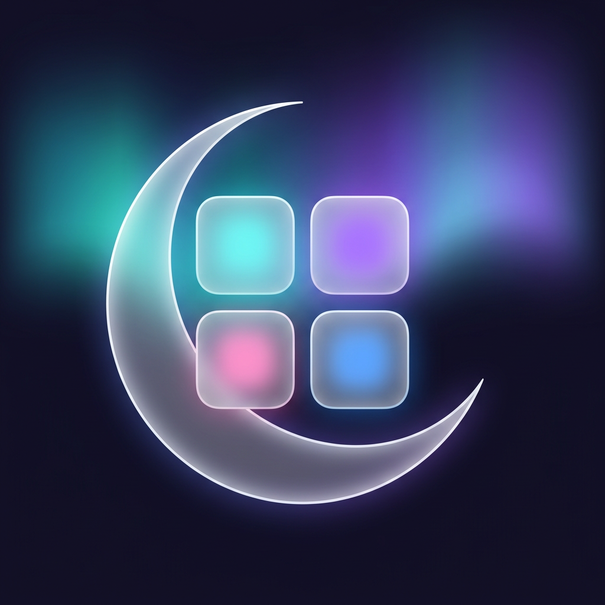

# Mirsa · مرسى

Mirsa for iPhone. App installation, container apps and on-device customization.

## Install

Add this source to your installer

https://github.com/Alaaaya/Mirsa/releases/download/setup/source.json

Direct alternative without release-download redirects

https://raw.githubusercontent.com/Alaaaya/Mirsa/main/source.json

Both links remain supported. The direct feed is updated automatically after successful release synchronization.

Includes Mirsa Setup and Alaa Player 2.9. Setup updates are checked every 15 minutes; GitHub may delay scheduled runs. Alaa Player is preserved across updates.

## Contact

[X · @rasmtk30](https://x.com/rasmtk30)

## Source and build

[Complete application source](app-source), including Rust source, Cargo.lock and build scripts, is published here. See [build instructions](app-source/README.md). The branding revision in this snapshot is awaiting its validation build and integration into the active publishing branch; the current setup package can still contain earlier app branding until that integration completes.

## Legal

Original copyright notices, licenses and component attribution are preserved in [LICENSE](LICENSE), [LICENSES](LICENSES) and [application notices](app-source/LICENSES). Mirsa is a branded derivative and does not claim original authorship of upstream components.
