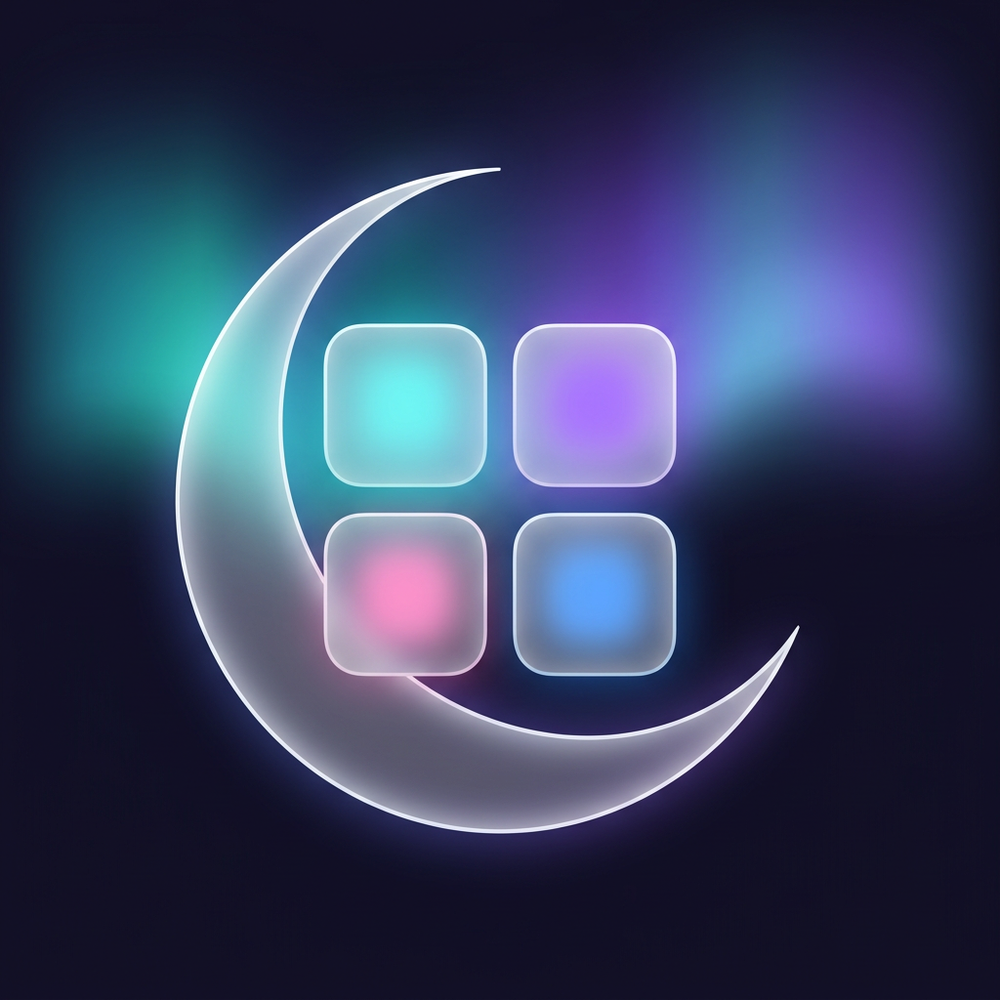

# Mirsa · مرسى

<p align="center"></p>

Mirsa brings app installation, container apps and on-device customization together on iPhone.

## Install

Add the [Mirsa source](https://github.com/Alaaaya/Mirsa/releases/download/setup/source.json) to your installer. It includes Mirsa Setup and Alaa Player.

## Contact

[X · @rasmtk30](https://x.com/rasmtk30)

## Build

The complete app source, Rust sources, Cargo.lock and build scripts are included.

```sh
git clone https://github.com/Alaaaya/Mirsa.git
cd Mirsa/app-source
bash build-ipa.sh
```

Building requires macOS, Xcode, XcodeGen and Rust. Internal project and package names remain unchanged for compatibility.

## Legal

Mirsa includes open-source components. Original copyright notices, component licenses and source attribution are retained in LICENSE and LICENSES. See [upstream attribution](LICENSES/UPSTREAM-ATTRIBUTION.md) and [sideloader notices](LICENSES/Sideloader-NOTICE.md). This is a branded derivative, not a claim of original authorship of upstream code.
